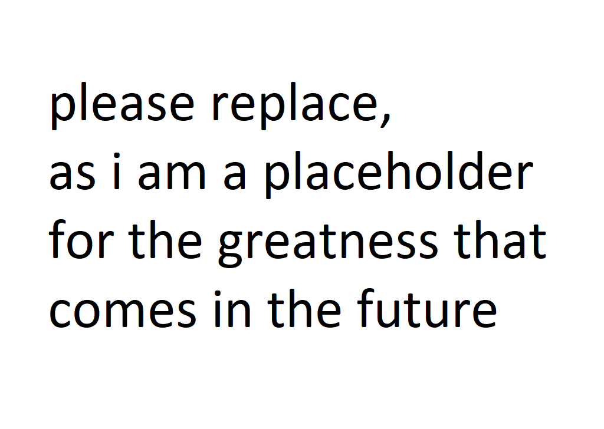

# *Web Name Here*
Lorem ipsum dolor sit amet, consectetur adipiscing elit, sed do eiusmod tempor incididunt ut labore et dolore magna aliqua. Ut enim ad minim veniam, quis nostrud exercitation ullamco laboris nisi ut aliquip ex ea commodo consequat. Duis aute irure dolor in reprehenderit in voluptate velit esse cillum dolore eu fugiat nulla pariatur. Excepteur sint occaecat cupidatat non proident, sunt in culpa qui officia deserunt mollit anim id est laborum.

# Main Feature
- feature here

    Lorem ipsum dolor sit amet, consectetur adipiscing elit, sed do eiusmod tempor incididunt ut labore et dolore magna aliqua.
- feature here

    Lorem ipsum dolor sit amet, consectetur adipiscing elit, sed do eiusmod tempor incididunt ut labore et dolore magna aliqua.
- feature here

    Lorem ipsum dolor sit amet, consectetur adipiscing elit, sed do eiusmod tempor incididunt ut labore et dolore magna aliqua.
- feature here

    Lorem ipsum dolor sit amet, consectetur adipiscing elit, sed do eiusmod tempor incididunt ut labore et dolore magna aliqua.

# Setup Instructions
## Requirements

- Git
- Docker Desktop with WSL 2 integration on Windows, or Docker Engine with the
  Docker Compose v2 plugin on Linux or macOS
- A Bash-compatible terminal (on Windows, use your WSL terminal)

Docker must be running before you start. With Docker handling PHP, Composer, and
Node.js, you do not need to install them on your host.

## First-time setup

Run these commands from the project root:

1. Copy the example environment file:

   ```bash
   cp .env.example .env
   ```

2. Install PHP dependencies using the Composer Docker image:

   ```bash
   docker run --rm \
     -u "$(id -u):$(id -g)" \
     -v "$PWD:/app" \
     -w /app \
     composer:2 install
   ```

3. Build and start the Sail containers:

   ```bash
   ./vendor/bin/sail up -d --build
   ```

4. Wait for the MySQL service to report `healthy` in
   `./vendor/bin/sail ps`, then generate the application key, migrate the
   database, and install frontend dependencies:

   ```bash
   ./vendor/bin/sail artisan key:generate
   ./vendor/bin/sail artisan migrate
   ./vendor/bin/sail npm install
   ```

5. Start the frontend development server:

   ```bash
   ./vendor/bin/sail npm run dev
   ```

   Open [http://localhost](http://localhost). Keep the Vite command running
   while developing; press `Ctrl+C` to stop it.

The provided environment uses MySQL in the Sail network. Its database host must
be `mysql` (not `localhost`). If port 80 is already in use, set `APP_PORT=8080`
and `APP_URL=http://localhost:8080` in `.env`, then open
[http://localhost:8080](http://localhost:8080). On Linux or WSL, if your user
or group ID is not `1000`, set `WWWUSER` and `WWWGROUP` in `.env` to the output
of `id -u` and `id -g`, respectively.

## Common commands

```bash
# Start the containers in the background
./vendor/bin/sail up -d

# Run the test suite
./vendor/bin/sail artisan test

# Stop the containers (the database volume is preserved)
./vendor/bin/sail down
```

To rebuild frontend assets for production, run
`./vendor/bin/sail npm run build`.

# Screenshots




P
